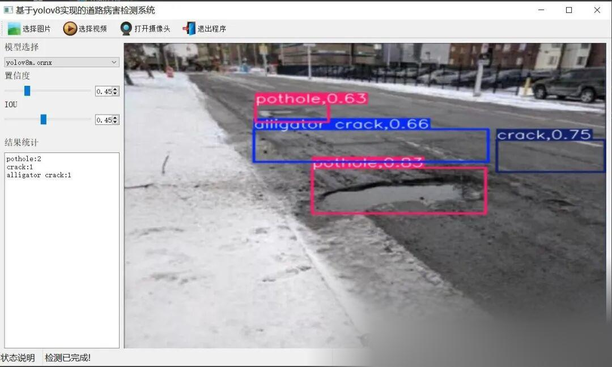

# Road Defect Detection System for Road Cracks, Dents, and Holes Based on Yolov8 in Python Source Code + ONNX Model + Evaluation Indicators Curve + High-quality GUI Interface

[Algorithm Introduction]The road defect detection system based on YOLOv8, especially for the detection of road cracks and pits, is an efficient and accurate intelligent solution.

[Algorithm Introduction]

The road defect detection system based on YOLOv8, especially for cracks and potholes, is an efficient and accurate intelligent solution. This system utilizes the advanced deep learning algorithm YOLOv8 to extract and classify features from images through a deep neural network, achieving real-time detection and recognition of road defects.

This system can automatically detect road cracks and potholes, accurately analyze the width, location, and severity of the damage. It greatly improves the efficiency and accuracy of road inspection. Compared with traditional manual inspection methods, this system not only reduces time costs and misjudgment rates but also ensures the timeliness and effectiveness of road maintenance.

In practical applications, the system can support various detection methods such as images, videos, and cameras, capable of displaying real-time detection results including the location, size, and confidence level of diseases. It also allows for the saving of detection results, facilitating subsequent analysis and processing. Additionally, the system can be integrated with intelligent transportation systems or urban management systems to continuously monitor road conditions, providing strong support for road maintenance and safety management.

In summary, the road defect detection system based on YOLOv8 is an innovative and practical intelligent solution. It applies deep learning technology to the field of road defect detection, providing strong support for road maintenance and safety management.

[Effect Display]



[Test Environment]

windows10
anaconda3+python3.8
torch==1.9.0+cu111
ultralytics==8.2.70

The model can detect the category.

Totally 22 categories are as follows:

Crocodile cracks
Blocky cracks
Bump-down droops
Splayed angles
Cracks
Brickwork splitting
Durability cracks
Edge cracks
Connection gaps
Seam blistering
Lateral cracks
Linear cracks
Longitudinal cracks
Repair hole cover
Blended cracks
Patches
Repairs
Holes
Wheel marks
Slippage cracks
Lateral cracks
Interlacing cracks

[Related dataset]

[Partial Implementation Source Code]

-
-
-
-
-
-
-
-
-
-
-
-
-
-
-
-
-
-
-
-
-
-
-
-
-
-
-
-
-
-
-
-
-
-
-
-
-
-
-
-
-
-
-
-
-
-
-
-
-
-
-
-
-
-
-
-
-
-
-
-
-
-
-
-
-
-
-
-
-
-
-
-
-
-
-
-
-
-
-
-
-
-
-
-
-
-
-
-
-
-
-
-
-
-
-
-
-
-
-
-
-
-
-
-
-
-
-
-

```
class Ui_MainWindow(QtWidgets.QMainWindow):    signal = QtCore.pyqtSignal(str, str)     def setupUi(self):        self.setObjectName("MainWindow")        self.resize(1280, 728)        self.centralwidget = QtWidgets.QWidget(self)        self.centralwidget.setObjectName("centralwidget")         self.weights_dir = './weights'         self.picture = QtWidgets.QLabel(self.centralwidget)        self.picture.setGeometry(QtCore.QRect(260, 10, 1010, 630))        self.picture.setStyleSheet("background:black")        self.picture.setObjectName("picture")        self.picture.setScaledContents(True)        self.label_2 = QtWidgets.QLabel(self.centralwidget)        self.label_2.setGeometry(QtCore.QRect(10, 10, 81, 21))        self.label_2.setObjectName("label_2")        self.cb_weights = QtWidgets.QComboBox(self.centralwidget)        self.cb_weights.setGeometry(QtCore.QRect(10, 40, 241, 21))        self.cb_weights.setObjectName("cb_weights")        self.cb_weights.currentIndexChanged.connect(self.cb_weights_changed)         self.label_3 = QtWidgets.QLabel(self.centralwidget)        self.label_3.setGeometry(QtCore.QRect(10, 70, 72, 21))        self.label_3.setObjectName("label_3")        self.hs_conf = QtWidgets.QSlider(self.centralwidget)        self.hs_conf.setGeometry(QtCore.QRect(10, 100, 181, 22))        self.hs_conf.setProperty("value", 25)        self.hs_conf.setOrientation(QtCore.Qt.Horizontal)        self.hs_conf.setObjectName("hs_conf")        self.hs_conf.valueChanged.connect(self.conf_change)        self.dsb_conf = QtWidgets.QDoubleSpinBox(self.centralwidget)        self.dsb_conf.setGeometry(QtCore.QRect(200, 100, 51, 22))        self.dsb_conf.setMaximum(1.0)        self.dsb_conf.setSingleStep(0.01)        self.dsb_conf.setProperty("value", 0.25)        self.dsb_conf.setObjectName("dsb_conf")        self.dsb_conf.valueChanged.connect(self.dsb_conf_change)        self.dsb_iou = QtWidgets.QDoubleSpinBox(self.centralwidget)        self.dsb_iou.setGeometry(QtCore.QRect(200, 160, 51, 22))        self.dsb_iou.setMaximum(1.0)        self.dsb_iou.setSingleStep(0.01)        self.dsb_iou.setProperty("value", 0.45)        self.dsb_iou.setObjectName("dsb_iou")        self.dsb_iou.valueChanged.connect(self.dsb_iou_change)        self.hs_iou = QtWidgets.QSlider(self.centralwidget)        self.hs_iou.setGeometry(QtCore.QRect(10, 160, 181, 22))        self.hs_iou.setProperty("value", 45)        self.hs_iou.setOrientation(QtCore.Qt.Horizontal)        self.hs_iou.setObjectName("hs_iou")        self.hs_iou.valueChanged.connect(self.iou_change)        self.label_4 = QtWidgets.QLabel(self.centralwidget)        self.label_4.setGeometry(QtCore.QRect(10, 130, 72, 21))        self.label_4.setObjectName("label_4")        self.label_5 = QtWidgets.QLabel(self.centralwidget)        self.label_5.setGeometry(QtCore.QRect(10, 210, 72, 21))        self.label_5.setObjectName("label_5")        self.le_res = QtWidgets.QTextEdit(self.centralwidget)        self.le_res.setGeometry(QtCore.QRect(10, 240, 241, 400))        self.le_res.setObjectName("le_res")        self.setCentralWidget(self.centralwidget)        self.menubar = QtWidgets.QMenuBar(self)        self.menubar.setGeometry(QtCore.QRect(0, 0, 1110, 30))        self.menubar.setObjectName("menubar")        self.setMenuBar(self.menubar)        self.statusbar = QtWidgets.QStatusBar(self)        self.statusbar.setObjectName("statusbar")        self.setStatusBar(self.statusbar)        self.toolBar = QtWidgets.QToolBar(self)        self.toolBar.setToolButtonStyle(QtCore.Qt.ToolButtonTextBesideIcon)        self.toolBar.setObjectName("toolBar")        self.addToolBar(QtCore.Qt.TopToolBarArea, self.toolBar)        self.actionopenpic = QtWidgets.QAction(self)        icon = QtGui.QIcon()        icon.addPixmap(QtGui.QPixmap(":/images/1.png"), QtGui.QIcon.Normal, QtGui.QIcon.Off)        self.actionopenpic.setIcon(icon)        self.actionopenpic.setObjectName("actionopenpic")        self.actionopenpic.triggered.connect(self.open_image)        self.action = QtWidgets.QAction(self)        icon1 = QtGui.QIcon()        icon1.addPixmap(QtGui.QPixmap(":/images/2.png"), QtGui.QIcon.Normal, QtGui.QIcon.Off)        self.action.setIcon(icon1)        self.action.setObjectName("action")        self.action.triggered.connect(self.open_video)        self.action_2 = QtWidgets.QAction(self)        icon2 = QtGui.QIcon()        icon2.addPixmap(QtGui.QPixmap(":/images/3.png"), QtGui.QIcon.Normal, QtGui.QIcon.Off)        self.action_2.setIcon(icon2)        self.action_2.setObjectName("action_2")        self.action_2.triggered.connect(self.open_camera)         self.actionexit = QtWidgets.QAction(self)        icon3 = QtGui.QIcon()        icon3.addPixmap(QtGui.QPixmap(":/images/4.png"), QtGui.QIcon.Normal, QtGui.QIcon.Off)        self.actionexit.setIcon(icon3)        self.actionexit.setObjectName("actionexit")        self.actionexit.triggered.connect(self.exit)         self.toolBar.addAction(self.actionopenpic)        self.toolBar.addAction(self.action)        self.toolBar.addAction(self.action_2)        self.toolBar.addAction(self.actionexit)         self.retranslateUi()        QtCore.QMetaObject.connectSlotsByName(self)        self.init_all()
```

[Usage Steps]

Usage Steps:
1. First, install the YOLOv8 environment according to the official framework https://github.com/ultralytics/ultralytics and PyQt5 installation tutorial.
2. After switching to your installed YOLOv8 environment, navigate to the source code directory and execute python main.py to start the interface for operation.

[Provided Files]

Python source code
YOLOv8m.onnx model (without PyTorch model)
Training map, P, R curves (in weights\results.png)
Test images (under test_img folder)

[Video demonstration]

Based on YOLOv8, a road defect detection system for cracks, potholes, and pits in roads using Python source code + ONNX model + evaluation metrics curve + exquisite GUI interface.

Test environment: Windows 10, Anaconda 3, Python 3.8, torch==1.9.0, cu111ultralytics==8.2.70
The model can detect 22 types of defects as follows: crocodile cracks, block cracks, protrusions, downwards, folds, cracks at edges, connections, seams, peeling, transverse cracks, linear cracks, longitudinal cracks, maintenance holes, cover plates, mixed cracks, patches, repairs, depressions, wheel grooves, slipping cracks, transverse cracks, intersected cracks, more information refer to the blog: https://blog.csdn.net/FLVideo playback volume 0, comment volume 0, like count 0, coin-throwing count 0, favorite count 0, share count 0, video author: Future Autonomous Research Center. Author's Biography: Future Autonomous Research Center. Relevant Videos: C# deployment of the Yolov8-ONNX image classification model using pure OpenCVSharp. [Python Game] Learn how to create a Mario game with just 20 lines of Python code, so fun you can't stop playing!! YOLOv8 detection interface - PyQt5 implementation, [Python source code] Does someone exist in your heart? Type out a love confession code to secretly express your feelings!
[Python project] A collection of 18 practical projects! (Includes source code) Including web crawling, film and television, music, automation, resources, games, etc. Easy to learn for beginners with no prior knowledge!
How to use ChatGPT4.0 in China, without the need for translation or magic, sharing official GPT4o experience!,  C# deploys DETIC detection with 20,100 categories using ONNX Runtime. Deploy the YOLOv8 image classification OpenVINO model in C#. Deploy the ONNX model of Yolox with ESL. Deploy the ONNX model of YOLOv10 using Python https://www.bilibili.com/video/BV1J4HVeEEw2/


## Payment

Here is a pay link on Stripe ( https://buy.stripe.com/3cs8yP7sY87d0vu9AB ). Please contact me lonlonago@foxmail.com after funding $89, and I will send you a complete data files , thank you!


